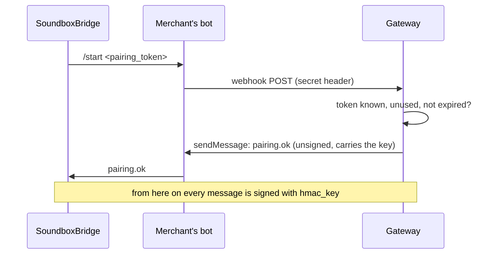

# QRIS Soundbox gateway protocol

This is the reference for everything a payment gateway exchanges with **SoundboxBridge**, the
Android app that drives a QRIS Soundbox. It applies to any gateway. For a worked integration with
the Midtrans Core API, see [midtrans-integration.md](midtrans-integration.md).

Protocol version: `v: 1`.

## Contents

- [Roles](#roles)
- [Transport: the merchant's own Telegram bot](#transport-the-merchants-own-telegram-bot)
- [Pairing link](#pairing-link)
- [Message envelope and signing](#message-envelope-and-signing)
- [Messages](#messages)
- [Timing and limits](#timing-and-limits)
- [Static or dynamic-only box](#static-or-dynamic-only-box)

## Roles

| Party | What it is |
|---|---|
| **Gateway** | Your backend. Makes the QR codes, learns about payments, talks to the app. |
| **Merchant's bot** | A Telegram bot the merchant creates with @BotFather. Its token is entered in your dashboard. All messages go through it. |
| **SoundboxBridge** | The app on the outlet's phone. Talks to the box over Bluetooth and to your bot over the merchant's Telegram account. |
| **Box** | The soundbox. Shows QR codes, announces payments. Never talks to you directly. |

SoundboxBridge has no server of its own, so the gateway never needs to call an app backend: the
bot chat is the whole channel.

## Transport: the merchant's own Telegram bot

- The merchant creates a bot with @BotFather and saves its token in your dashboard.
- You call [`setWebhook`](https://core.telegram.org/bots/api#setwebhook) once for that bot, with a
  `secret_token`. Telegram then POSTs every message sent to the bot to your URL, with the
  `X-Telegram-Bot-Api-Secret-Token` header set to that secret.
- Check the header, answer `200` at once, and handle the update from a queue. Telegram retries
  failed or slow deliveries and keeps undelivered updates for up to 24 hours.
- You reply with ordinary [`sendMessage`](https://core.telegram.org/bots/api#sendmessage) calls to
  the chat the app wrote from.
- A bot has one webhook. While it is set, `getUpdates` doesn't work, so the merchant must not
  connect the same bot to anything else.

Use a webhook path that tells you which merchant it is, e.g. `https://gw.example.com/telegram/<merchant id>`.

## Pairing link

Your dashboard shows the outlet's pairing link as a QR code; the merchant scans it in
SoundboxBridge (*Branches → Branch phone → Scan owner's QR*, or *Paste link*).

```
soundboxbridge://pair?d=<base64url of the JSON below, padding removed>
```

```json
{
  "v": 1,
  "role": "owner",
  "provider": "MIDTRANS",
  "merchant_name": "Kopi Senja",
  "outlet_id": "OUT-0012",
  "outlet_name": "Kopi Senja Bekasi",
  "qr_mode": "dynamic",
  "pin": "1234",
  "transport": { "type": "telegram_bot", "bot": "KopiSenjaKasirBot" },
  "pairing_token": "pt_8f3c0b1e2a4d6c8e0f1a2b3c",
  "expires_at": "2026-11-12T14:10:00+07:00"
}
```

| Field | Required | Rules |
|---|---|---|
| `v` | yes | `1` |
| `role` | yes | `"owner"` (the gateway acts as the owner, the phone becomes its branch) |
| `provider` | yes | Your name as the merchant sees it, up to 40 characters |
| `merchant_name` | no | Up to 80 characters |
| `outlet_id` | yes | Your outlet id. Every signed message carries it |
| `outlet_name` | no | Up to 80 characters. Shown in the app and, on a dynamic-only box, on the box |
| `qris` | see below | The outlet's static QRIS, with a valid CRC |
| `qr_mode` | see below | `"dynamic"` when there is no static QRIS |
| `pin` | no | 4 to 16 digits. The box settings PIN; omit it to let the app keep its own |
| `transport.type` | yes | `"telegram_bot"` |
| `transport.bot` | yes | The bot's username, without `@` (5 to 32 characters, starts with a letter) |
| `pairing_token` | yes | `[A-Za-z0-9_-]`, 1 to 64 characters (it goes in Telegram's `/start` parameter). One use only |
| `expires_at` | yes | ISO 8601 with an offset, or Unix seconds. 10 minutes is a good lifetime |

Send **either** `qris` (a static QRIS the box can fall back on) **or** `"qr_mode": "dynamic"` (no
static QRIS; see [Static or dynamic-only box](#static-or-dynamic-only-box)). A link with neither is
rejected. App versions without dynamic-only support reject a link without `qris`.

### Pairing handshake



1. The app starts the bot with `/start <pairing_token>`.
2. You check the token (known, unused, not expired), mark it used, and create a device: a
   `device_id` and a random signing key of 32 bytes.
3. You remember the Telegram `chat.id` the `/start` came from: that chat is this device.
4. You answer `pairing.ok`, the only unsigned message:

```
#QRISSB {"v":1,"type":"pairing.ok","pairing_token":"pt_8f3c...","device_id":"dev_9a1b2c3d","outlet_id":"OUT-0012","hmac_key":"<base64, 32 bytes>","ts":1794467400}
```

The app ignores `pairing.ok` unless `pairing_token` and `outlet_id` match the link it scanned. The
key must decode to at least 16 bytes.

## Message envelope and signing

Every message after pairing is one Telegram text:

```
#QRISSB <json>|<sig>
```

- `<json>` is the message, compact JSON in UTF-8.
- `<sig>` is the lowercase hex HMAC-SHA256 of **the exact bytes of `<json>`**, keyed with the
  decoded `hmac_key` (64 hex characters).
- `#QRISSB ` ends with one space. Receivers also accept it without the space.

Verify against the text you received, never a re-serialised copy: JSON libraries may reorder keys
or escape characters differently. Split at the **last** `|`, check the part after it is 64
characters, and compare in constant time. Ready-made code in five languages is in
[examples/signing](../examples/signing).

Every signed message has these fields:

| Field | Meaning |
|---|---|
| `v` | `1` |
| `type` | The message type |
| `device_id` | From `pairing.ok` |
| `outlet_id` | From the pairing link |
| `ts` | Unix seconds when it was sent |

Both sides drop a message if the signature is wrong, `device_id` or `outlet_id` don't match, or
`ts` is more than **300 seconds** from their own clock. Other bot chatter (text not starting with
`#QRISSB`) is ignored.

## Messages

| Type | Direction | When |
|---|---|---|
| [`pairing.ok`](#pairing-handshake) | gateway → app | Answer to `/start` |
| [`qr.request`](#qrrequest) | app → gateway | A bill was printed from the POS |
| [`qr.created`](#qrcreated) | gateway → app | The QR for that bill |
| [`qr.failed`](#qrfailed) | gateway → app | No QR can be made |
| [`qr.cancel`](#qrcancel) | app → gateway | The app no longer waits for that QR |
| [`payment.succeeded`](#paymentsucceeded) | gateway → app | A payment to this outlet settled |
| [`outlet.updated`](#outletupdated) | gateway → app | Outlet name, QRIS or PIN changed |
| [`device.revoked`](#devicerevoked) | gateway → app | The phone is unpaired |
| `ping` | gateway → app | Accepted and ignored |

### qr.request

The box printed a bill (its amount and, if found on the receipt, the POS order number).

```json
{"v":1,"type":"qr.request","device_id":"dev_9a1b2c3d","outlet_id":"OUT-0012","ts":1794467500,
 "request_id":"sb_0a1b2c3d","amount":95000,"currency":"IDR","pos_ref":"SO1"}
```

| Field | Rules |
|---|---|
| `request_id` | `sb_` + 8 hex digits. Echo it in your answer |
| `amount` | Whole rupiah, 1 to 999,999,999 |
| `currency` | `"IDR"` |
| `pos_ref` | Optional, up to 25 characters: the POS order number. Put it in the QR's bill number (tag 62, sub-tag 01) and echo it as `reference` in `payment.succeeded` |

A new bill replaces the previous one: the app sends `qr.cancel` for the old `request_id` first.

### qr.created

```json
{"v":1,"type":"qr.created","device_id":"dev_9a1b2c3d","outlet_id":"OUT-0012","ts":1794467501,
 "request_id":"sb_0a1b2c3d","amount":95000,"qris":"00020101021226...6304ABCD",
 "expires_at":"2026-11-12T14:21:41+07:00"}
```

| Field | Rules |
|---|---|
| `request_id` | From the request |
| `amount` | Must be within the request's amount (±99) |
| `qris` | A dynamic QRIS with a valid CRC whose amount (tag 54) equals `amount` |
| `expires_at` | ISO 8601 or Unix seconds. The box shows the QR until then, clamped to 10 to 900 seconds; without it, 60 seconds |

If the amount, CRC or tag 54 don't match, the app treats the answer as a failure. It must arrive
within the [8-second window](#timing-and-limits).

### qr.failed

```json
{"v":1,"type":"qr.failed","device_id":"dev_9a1b2c3d","outlet_id":"OUT-0012","ts":1794467501,
 "request_id":"sb_0a1b2c3d","reason":"gateway error"}
```

`reason` is free text (the app logs the first 80 characters). Send it as soon as you know, rather
than letting the request time out.

### qr.cancel

```json
{"v":1,"type":"qr.cancel","device_id":"dev_9a1b2c3d","outlet_id":"OUT-0012","ts":1794467510,
 "request_id":"sb_0a1b2c3d"}
```

Sent when a newer bill replaces the request, or when your `qr.created` came too late. You may
cancel the transaction on your side; if it gets paid anyway, still send `payment.succeeded`.

### payment.succeeded

```json
{"v":1,"type":"payment.succeeded","device_id":"dev_9a1b2c3d","outlet_id":"OUT-0012","ts":1794467560,
 "event_id":"c8c98727-2880-4c4a-8cfa-a31a459d8cef","request_id":"sb_0a1b2c3d","amount":95000,
 "currency":"IDR","reference":"SO1","issuer":"GOPAY","paid_at":"2026-11-12T14:12:40+07:00",
 "rrn":"123456789012"}
```

| Field | Rules |
|---|---|
| `event_id` | Required, unique per payment. The app drops repeats, so resending is safe |
| `amount` | Required, whole rupiah, 1 to 999,999,999 |
| `currency` | `"IDR"` (anything else is ignored) |
| `request_id` | Optional: ties the payment to the printed bill in the app. (The box closes a bill's QR when a payment of that bill's amount arrives) |
| `reference` | Optional: the `pos_ref` of that bill |
| `issuer` | Optional: shown in the app next to the amount |
| `paid_at`, `rrn` | Optional: for your records and the app log |

The box announces the payment ("Pembayaran diterima, sembilan puluh lima ribu rupiah"). The app
only announces messages that reach it within **120 seconds**; older ones are shown in the app,
not spoken, so a phone that was offline doesn't announce a burst of old payments.

### outlet.updated

```json
{"v":1,"type":"outlet.updated","device_id":"dev_9a1b2c3d","outlet_id":"OUT-0012","ts":1794467600,
 "outlet_name":"Kopi Senja Bekasi Timur"}
```

Optional fields: `outlet_name`, `merchant_name`, `qris` (a new static QRIS; the app sends it to the
box), `pin` (a new box PIN). On a dynamic-only box a new `outlet_name` also renews the name the box
shows.

### device.revoked

```json
{"v":1,"type":"device.revoked","device_id":"dev_9a1b2c3d","outlet_id":"OUT-0012","ts":1794467700}
```

The app forgets the pairing and turns the box's gateway mode off. Delete the device and its key on
your side.

## Timing and limits

| What | Value | Where |
|---|---|---|
| Answer to `qr.request` | **8 seconds**, from the bill being printed | Box (`PG_WAIT_MS`) and app (`BOX_WAIT_MS`) |
| QR display time | 10 to 900 seconds, from `expires_at` (60 s without it) | Box and app |
| Clock difference | 300 seconds | Both sides check `ts` |
| Announce window | 120 seconds after the message is sent | App |
| Amounts | 1 to 999,999,999 rupiah | Box voice |

The 8 seconds include two Telegram hops, so aim to send `qr.created` within about 3 seconds of
the webhook POST. Answer the webhook first, then call your QR system from a queue.

## Static or dynamic-only box

**Static** (the link carries `qris`): when your QR doesn't come in time, or `qr.failed` arrives,
the box makes its own dynamic QR from the static QRIS. Payments to that fallback QR only reach the
box if they also reach you.

**Dynamic-only** (`"qr_mode": "dynamic"`, box firmware 1.3.0 or newer): for gateways with no static
QRIS, such as Midtrans.

- The app gives the box an identity instead of a QRIS, built from `outlet_name`.
- While idle, the box shows a "Kami menerima" (we accept) QRIS / GPN badge and the outlet name.
- Every QR comes from you. Where a static box would make its own QR (late answer, `qr.failed`, a
  QR that's not within tolerance of the bill, phone not connected), the box shows **"QR gagal / Cetak ulang
  tagihan"** (QR failed, print the bill again) instead.
- Older firmware refuses the identity, and the app asks the merchant to update the box.
